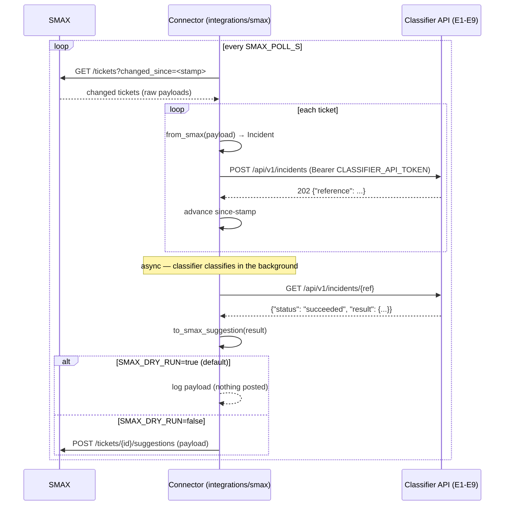

# SMAX Ticketing Connector (`integrations/smax`)

The standalone connector between the **SMAX ticketing system** (upstream) and the
**AI incident classifier** (downstream). It runs as its **own process** and talks
to the classifier **only through its public HTTP API** — it imports *nothing* from
`ai_classification` and can be deployed on a machine that has only network access
to the classifier API.

```
┌──────────┐   changed tickets    ┌────────────────────┐   POST /api/v1/incidents   ┌──────────────┐
│   SMAX   │ ───────────────────► │  integrations/smax  │ ─────────────────────────► │  Classifier  │
│ (upstream)│ ◄─────────────────── │     (connector)     │ ◄───────────────────────── │  (E1–E9 API) │
└──────────┘  suggestion payload  └────────────────────┘   GET /api/v1/incidents/{ref}└──────────────┘
```

## What it does

1. **Poller** (`poller.py`) — every `SMAX_POLL_S` seconds, list SMAX tickets
   changed since the local since-stamp (`SMAX_SYNC_STAMP_PATH`), translate each
   with `from_smax`, and submit it via `POST /api/v1/incidents` (async ingest).
   Advance the stamp to the newest `updated_at`. The stamp is **runtime state,
   never committed to git**; idempotency comes free from the server
   (content-hash + `source_reference` dedupe).
2. **Write-back** (`writeback.py`) — for each submitted reference, poll
   `GET /api/v1/incidents/{ref}` until the result is ready, build the SMAX
   suggestion payload with `to_smax_suggestion`, and post it to the SMAX side
   channel. **Dry-run by default** (`SMAX_DRY_RUN=true`): the payload is logged,
   never posted.

Both sides share **one transport** (`http_client.py`): bearer auth, JSON
encode/decode, timeouts, and one retry policy (429 always; 5xx/timeouts only for
idempotent GETs — a POST is never repeated because the server may have applied
it). Endpoint methods are then 1–2 lines each.

## Run it

```bash
# From the repo root (env-driven, no code config):
export SMAX_BASE=https://smax.example.com
export SMAX_TENANT=mytenant
export SMAX_USER=integration-user
export SMAX_PASS=…
export CLASSIFIER_API_URL=http://localhost:8000
export CLASSIFIER_API_TOKEN=secret   # same as the server's INTEGRATION_API_TOKEN
export SMAX_DRY_RUN=true             # default: log only, post nothing

.venv/bin/python -m integrations.smax.main
```

One-shot modes:

```bash
# Print the resolved config (tokens masked) — no network needed:
.venv/bin/python -m integrations.smax.main --check

# One poll tick + one write-back sweep, then exit:
.venv/bin/python -m integrations.smax.main --once

# Historical backfill from a JSON file of incidents (chunked ≤200/call):
.venv/bin/python -m integrations.smax.main --backfill incidents.json --since 2025-01-01T00:00:00Z
```

`incidents.json` is a JSON list (or `{"incidents": [...]}`) of normalized
incidents `{source_reference, title, description, status?, created_at?, updated_at?}`
— raw SMAX payloads (keys like `ticket_id`/`title`) are also accepted and
translated with `from_smax`.

## First live run (nothing to break)

Work up in four steps; each one is safe to repeat.

```bash
# 1. configuration — no network, no credentials needed
python -m integrations.smax.main --check

# 2. ONE incident: proves login, the search filter and the field mapping.
#    Submits nothing, writes nothing. Add --probe-download to fetch the files
#    as well, or --probe-raw to see the raw entity (to verify field names).
python -m integrations.smax.main --probe 100001

# 3. one REAL ticket, capped, write-back still dry-run
SMAX_MAX_INCIDENTS_PER_TICK=1 python -m integrations.smax.main --once --limit 1

# 4. normal operation
python -m integrations.smax.main
```

Why it is hard to break:

- **Re-running is always safe.** The classifier dedupes by `source_reference`, so
  a ticket that was already ingested is matched, not duplicated.
- **A cap defers, it never drops.** The stamp stops *before* the tickets held
  back, so the next tick resumes there; nothing is skipped and nothing is
  re-sent twice. It bounds the **read** as well: a capped tick lists one ticket
  past the cap instead of dragging the whole change list off SMAX.
- **One bad ticket cannot lose the batch.** Unreadable attachment metadata, a
  failed download, a missing `Id` — each is logged and skipped; the rest of the
  tick continues.
- **A failed listing never advances the stamp**, so the worst case is re-listing.
- **SMAX is never written to.** Write-back has no documented endpoint, so it
  logs the payload it would post and posts nothing.
- Every mode exits `1` with a one-line message instead of a traceback.

## Configuration

**Everything SMAX-specific lives in this folder** — nothing belongs in the app's
`.env` at the repo root.

```bash
cp backend/integrations/smax/.env.example backend/integrations/smax/.env
# then edit it, or rely on real env vars (they override the file)
```

`config.py` loads the sibling `.env` when it exists, so the connector runs
straight from here with no exports:

```bash
.venv/bin/python -m integrations.smax.main --check     # prints the resolved config, tokens masked
```

The only value shared with the app is the classifier token: `CLASSIFIER_API_TOKEN`
here must equal the server's `INTEGRATION_API_TOKEN`.

Running it in Kubernetes — the connector is its own Deployment; the manifest
belongs in this folder and points at the classifier Service the app exposes
(`CLASSIFIER_API_URL=http://ai-classifier-backend.<ns>.svc:8000`). Its config
comes from a Secret holding the `SMAX_*` / `CLASSIFIER_API_*` keys.

### Write-back is not implemented

The handover documents authentication, incident search and attachment download —
**no write endpoint**. `write_suggestion()` therefore refuses (and the write-back
loop logs the payload instead of posting), so `SMAX_WRITE_BACK` /
`SMAX_DRY_RUN` cannot yet change what happens on the wire. Confirm the API and
its permissions before enabling it.

## Environment variables

| Variable | Default | Purpose |
| --- | --- | --- |
| `SMAX_BASE` | *(unset — required)* | Base URL of the SMAX server (`SMAX_API_URL` is accepted as an alias). |
| `SMAX_TENANT` | *(unset — required)* | Target tenant id, sent as the `TENANTID` query param and cookie. |
| `SMAX_USER` / `SMAX_PASS` | *(unset — required)* | The integration account. Auth is a login exchange — there is **no** static token. |
| `SMAX_TOKEN_TTL_S` | `1500` | Client-side token refresh interval; a 401/403 always forces a refresh anyway. |
| `SMAX_PAGE_SIZE` | `250` | Search page size (the SMAX API caps it at 250). |
| `SMAX_ENTITY_FIELD` | `Entity_c` | The tenant's custom entity field, if it is named differently. Always requested in the layout — asking for it is how `--probe` verifies the field name against a real tenant. |
| `SMAX_UTC_OFFSET_HOURS` | `3` | Fixed UTC offset used to turn date boundaries into epoch ms (3 = Riyadh). |
| `SMAX_MAX_ATTACHMENT_MB` | `15` | Attachments up to this size are downloaded and sent as base64; larger ones go by name only. |
| `SMAX_DRY_RUN` | `true` | `true` → write-back only LOGS the suggestion payload; `false` → posts to SMAX. |
| `SMAX_POLL_S` | `60` | Poll interval (seconds) for the SMAX change poller. |
| `SMAX_SYNC_STAMP_PATH` | `./.last_sync` | Local since-stamp file (runtime state; never committed). |
| `SMAX_WRITE_BACK` | `suggestions` | `none` → never write; `suggestions` (default) → SMAX side channel; `full` → same write path (the connector never mutates ticket fields directly). |
| `CLASSIFIER_API_URL` | `http://localhost:8000` | Base URL of the classifier's public API. |
| `CLASSIFIER_API_TOKEN` | *(unset — required)* | Bearer token for the classifier API — the server's `INTEGRATION_API_TOKEN`. Refuses to start without it. |

## Sequence diagram



## Extending it (for the next change)

The transport lives in exactly one place (`http_client.py`), and the ingest body
in exactly one function (`incident_payload`), so a change is one small edit:

| You want to… | File | How |
|---|---|---|
| call a new **SMAX** endpoint | `smax_client.py` | add one method: `return self.get_json("/new/path")` (or `self.post_json(path, body)`) — auth, retries and timeouts come from the base class |
| call a new **classifier** endpoint | `classifier_client.py` | same shape: one `self.get_json(...)` / `self.post_json(...)` method |
| send a new **field** with an incident | `classifier_client.py` | add it once in `incident_payload()`; `submit` and `backfill` both use it, and a test fails if they drift |
| translate new **SMAX ticket fields** | `smax_models.py` | `from_smax()` (SMAX payload → `Incident`), `to_smax_suggestion()` (result → SMAX write-back) |
| change **polling** or the since-stamp | `poller.py` | `run_once()` is exactly one tick; the stamp file is `SMAX_SYNC_STAMP_PATH` |
| change **write-back** | `writeback.py` | gated by `SMAX_WRITE_BACK` / `SMAX_DRY_RUN` |
| add a **setting** | `config.py` + the table above | read it with `_env("SMAX_…")`; fail loud in a `require_*()` guard when it is mandatory |

**Testing a new call:** `tests/conftest.py` gives you a fake SMAX server
(`fake_smax`) and a fake classifier API (`fake_classifier`) on ephemeral ports,
both recording every request — no network, no LLM, no import of the app. Copy the
pattern from `tests/test_classifier_client.py` or `tests/test_poller.py`.

```bash
.venv/bin/python -m pytest integrations/smax/tests -q      # 37 tests, ~13s
```

Two rules the tests enforce, so follow them rather than discovering them in
production: the ingest body never grows a field outside the documented contract
(the API rejects unknown fields with **422**), and `submit` / `backfill` always
send the same body for the same incident.

## Tests

```bash
PG_PORT=5432 .venv/bin/pytest integrations/smax/tests/ -q
```

Unit tests only: fake SMAX + fake classifier HTTP servers on ephemeral ports
(`http.server.ThreadingHTTPServer`), no network, no LLM, no `ai_classification`.

## Containment

This package is standalone by construction: `grep -rn "ai_classification" integrations/`
must return nothing (except README prose). Enforced in CI like the pre-existing
containment grep for SMAX field names.
